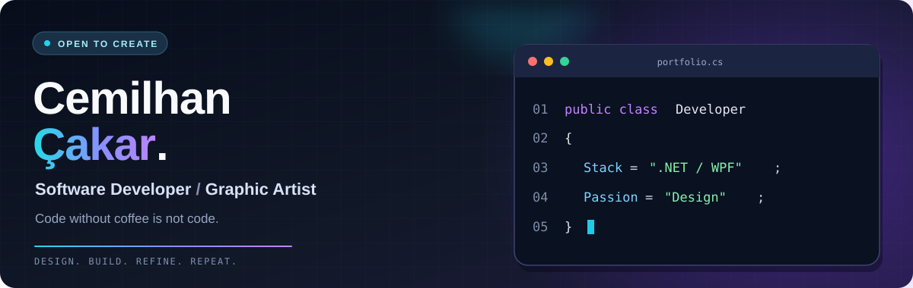
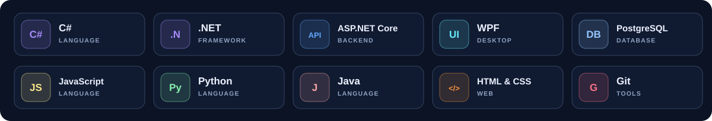
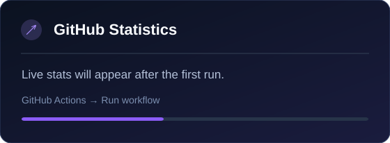
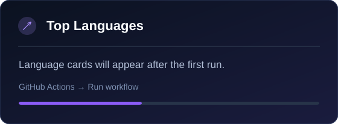

<!--
  GitHub Profile • Cemilhan Çakar
  All images are stored locally in this repo: no broken third-party image CDNs.
  Dynamic stats are regenerated by .github/workflows/profile-stats.yml.
-->

  

  

    &nbsp;
    &nbsp;
    &nbsp;
    
  

  **Turning complex ideas into useful software and memorable visuals.**

## 👋 A little about me

I enjoy connecting **software engineering** with **visual design** — from desktop experiences to scalable back-end systems.

- 💻 I build with **C#, .NET, ASP.NET Core, and WPF**.
- 🗃️ I work with **PostgreSQL, APIs, and clean architecture**.
- 🎨 I'm interested in **graphic design, branding, and UI/UX**.
- ☕ My philosophy: **Code without coffee is not code.**

## 🛠️ Tech stack

  

## 🚀 Featured projects

| Project | What it is | Repository |
|:--|:--|:--|
| **🎓 YKS Score Calculator** | University entrance exam score calculator | [View code](https://github.com/cemilhancakar/yksekpuanhesaplama) |
| **🌐 Roboc Frontend** | Web interface and frontend project | [View code](https://github.com/cemilhancakar/roboc-sitesi-frontend) |
| **✅ JavaScript To-Do List** | Lightweight task management exercise | [View code](https://github.com/cemilhancakar/javascript-to-do-list) |
| **🎨 Basics of Web Design** | Web design fundamentals and practice | [View code](https://github.com/cemilhancakar/basics-of-web-design) |

## 📊 GitHub at a glance

  
  

Statistics are generated in this repository with GitHub Actions. The cards are stored here as SVG files instead of depending on a public statistics CDN. Language percentages describe public repositories, not necessarily skill level.

---

  *Thanks for stopping by! Feel free to explore my repositories or connect with me.*

  <a href="https://github.com/cemilhancakar?tab=repositories"><strong>Explore all repositories</strong></a>

